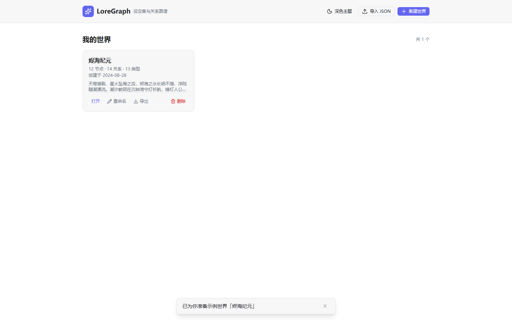
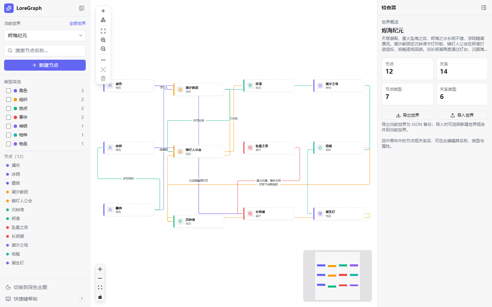
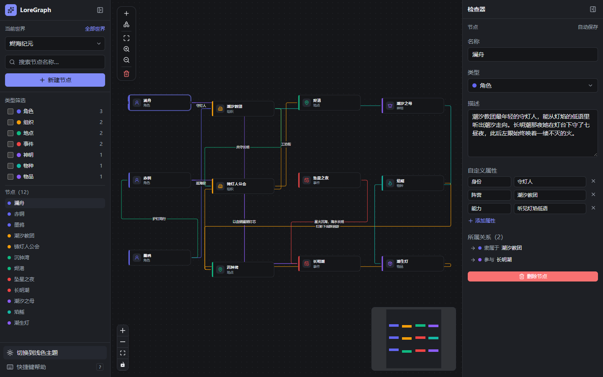
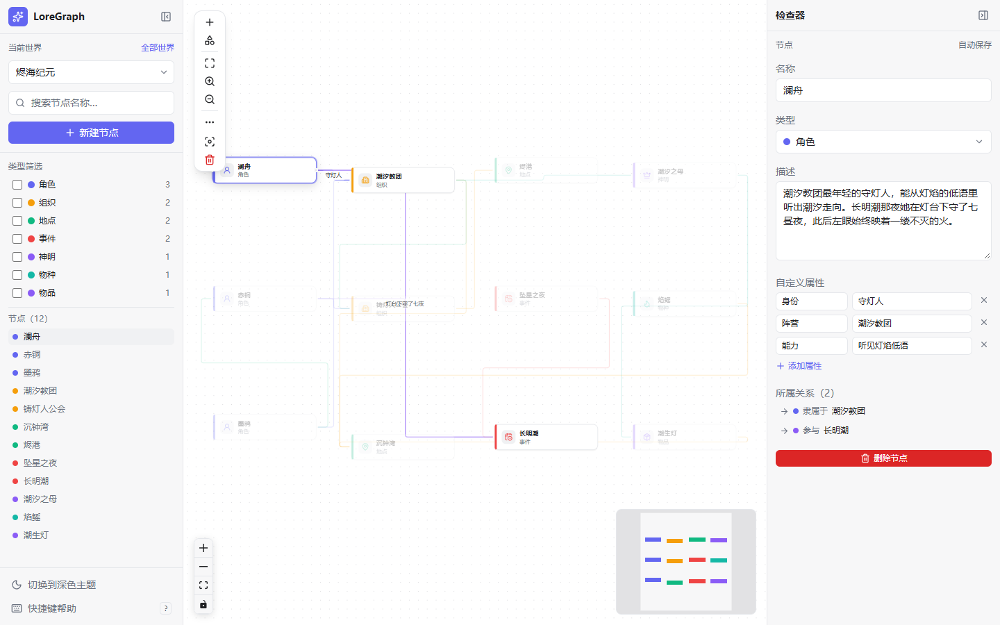

# LoreGraph

**A local-first knowledge graph for building and exploring fictional worlds.**

LoreGraph is a Web-first worldbuilding tool for writers, game masters, and anyone who keeps a
setting bible. Characters, places, factions, events, and objects become nodes on an infinite
canvas; the relationships between them become directed edges. Everything runs in your browser,
everything is saved locally, and there is no account, no backend, and no telemetry.

The interface is written in Chinese; this README is available in
[English](README.md) and [简体中文](README.zh-CN.md).

## Screenshots

**Universe library** — manage multiple worlds from one local library.



**Workspace** — graph canvas with the sidebar and inspector (light theme).



| Dark theme                                                      | Inspector                                                                   |
| --------------------------------------------------------------- | --------------------------------------------------------------------------- |
|  |                  |
| The same world with the dark theme.                             | Editing a node's name, type, description, custom properties, and relations. |

All screenshots are captured at 1440×900.

## Features

- **Local-first by design.** Worlds live in IndexedDB in your browser. No sign-up, no server,
  and your data is never uploaded.
- **Graph canvas.** Pan, zoom, drag nodes, and connect them by dragging from a node handle;
  a dialog asks for the relation type and an optional label. The canvas ships with a background
  grid, zoom/fit controls, and a pannable minimap, and validates self-loops and duplicates as
  you connect.
- **Entity types.** Create, rename, recolor, and delete node types and relation types in the
  type manager; each type has a Chinese label, a color, and an optional icon, and shows how many
  nodes or relations use it. New worlds start with six node types (角色, 组织, 地点, 事件, 物品,
  概念) and six relation types (隶属于, 结盟, 位于, 参与, 导致, 相关).
- **Inspector.** Edit a node's name, type, long-form description, and arbitrary custom
  properties (string, number, or boolean); browse its incident relations and jump to them. For
  edges, edit the relation type, label, and properties. When nothing is selected it shows the
  world description, world statistics, and world export/import actions.
- **Automatic layout.** Lay out the whole graph in one click with elkjs — force-directed (the
  default) or layered top-down. Layout only changes coordinates; the positions from before the
  first layout stay in memory and can be undone from the success toast or restored later via
  更多 → 恢复布局前位置, even after further layouts. The snapshot is not persisted, so reloading
  loses it.
- **Stable viewport.** Resizing the window or opening/closing the sidebar and inspector keeps the
  content at the centre of the canvas, and the view refits after a layout, a restore, or a graph
  snippet import.
- **Search and filters.** Find nodes by name (case-insensitive substring), browse the matches
  in the sidebar node list, see them highlighted on the canvas, and show or hide nodes by type
  with per-type counts.
- **Grouped node library.** The sidebar lists nodes grouped by type — type colour, label, and
  count per group — with per-group and whole-list collapse. The collapse preference is kept per
  world in `localStorage`, and a search temporarily expands the groups that match. The type
  filter is a separate collapsible section that controls canvas visibility, not the list.
- **Node folding.** A node with outgoing relations can be folded: its descendants and the
  relations reaching them leave the canvas, and a badge on the folded node counts what is hidden.
  Folding is view state, stored per world; it never enters the data model or the export files.
- **Large graphs stay readable.** From 100 nodes or 300 relations the canvas keeps every node card
  but starts with no relation lines; clicking a node reveals all of its direct incoming and
  outgoing relations, and clicking a neighbour reveals the next layer. The chevron on a node
  toggles its relations (keyboard accessible), the expansion state is kept per world, and locating
  a node from search or the sidebar expands only that node's own hop.
- **Readable relations.** Parallel and mutual relations between the same pair of nodes are spread
  onto separate lanes with labels on either side instead of stacking on one path, and a toolbar
  switch turns the direction arrows on or off for every relation at once.
- **Workspace header and clustering.** A context header names the current world and view;
  更多 → 自动布局（按类型）clusters nodes by type before arranging the clusters, and cross-type
  relations stay visible.
- **Adjacency highlighting and Focus Mode.** Selecting a node keeps it, its direct neighbours,
  and its relations sharp while everything else fades; selecting a relation keeps it and its two
  endpoints. Press `F` (or the toolbar button) to show only that node and its direct neighbours,
  with a banner to leave it; `Esc` also leaves Focus Mode. `F` prefers the visible node under the
  pointer over the selection, and while focused, hovering another visible node moves the centre.
- **Focus that keeps its scale.** On a large graph, entering or moving Focus Mode keeps the
  current zoom and centres the focus node; small graphs and leaving the mode still fit the
  neighbourhood. Every visible neighbour whose card lies completely outside the canvas gets a
  marker on the matching edge with a direction arrow and its name, refreshed as you pan, zoom, or
  resize a panel. Clicking or activating a marker selects that node and centres it at the current
  zoom without moving the focus centre.
- **Drag undo.** `Ctrl/⌘+Z` steps back through the last 50 node drags, saving each restored
  position through autosave. A drop that does not move the node is not recorded, the shortcut is
  ignored while typing, while a dialog is open, and during a drag, and the history is cleared when
  you switch worlds or run an automatic layout.
- **Inspector sections.** Custom properties start collapsed and 所属关系 (relations) starts
  expanded; each section toggles independently, and folding only hides content, so the rows and
  any selected relation survive. Opening a relation from a node records the source node and shows
  a 返回节点检查器 button that goes back.
- **Root `worlds/` import.** `.loregraph.json` files placed in `worlds/` at the project root are
  discovered when the world list starts and imported through the normal import pipeline. A
  failing file is skipped on its own, and an already imported source `universe.id` never comes
  back — not on reload, not from a duplicate file, and not after you delete the imported world.
- **Keyboard shortcuts.** `N` creates a node, `F` enters or leaves Focus Mode,
  `Delete`/`Backspace` deletes the selection, `Esc` cancels or leaves Focus Mode,
  `Ctrl/⌘+Z` undoes the last node drag, `Ctrl/⌘+K` focuses search, `?` opens the shortcut help.
- **Autosave.** Edits are applied to the UI immediately and flushed to IndexedDB after a short
  debounce; failed writes roll back to the last persisted state.
- **Safe deletion.** Deleting a node removes its relations atomically and offers an undo toast.
  A type that is still in use cannot be deleted.
- **Universe management.** Create, edit, and delete worlds (name + description) from a card
  library with per-world node/edge/type counts; the description also appears in the card and the
  inspector's world overview. Each world has its own types, nodes, and relations.
- **Sample world.** An original Chinese fantasy world (烬海纪元) is bundled and loaded
  automatically the first time you open the app when the library is empty, so it is never an
  empty canvas; it can also be loaded from the empty state.
- **JSON import and export.** Two kinds of `.loregraph.json` files: a **world file**
  (`format: "loregraph.universe"`) with everything in one world, and a **graph snippet**
  (`format: "loregraph.graph"`) with just the selected nodes, their internal relations, and the
  types they use. Import is always two steps — analyze the file, review counts, types, conflicts,
  duplicate names, and warnings, then commit — and supports importing a world file as a new world
  (from the library or the inspector) or merging it into the current world (from the inspector).
  Graph snippets are imported from the graph toolbar's 更多 menu and always merge. Merging never
  overwrites: types are reused by `scope + key`, nodes and relations get fresh ids, and same-name
  nodes are only reported. Export a world from its card or the inspector, and a snippet from
  更多 — snippet export drops relations with one endpoint outside the selection and reports how
  many. Field definitions, validation rules, and merge rules are in
  [the data format](docs/data-format.md).
- **Light and dark themes.** Follows your system preference by default and remembers your
  choice.
- **Responsive workspace.** Three panes on desktop; on narrow screens the sidebar and inspector
  become overlay drawers.

## Tech stack

| Area         | Choice                                                         |
| ------------ | -------------------------------------------------------------- |
| UI framework | Vue 3 (Composition API, `<script setup lang="ts">`)            |
| Language     | TypeScript (strict)                                            |
| Build tool   | Vite 8 + `@vitejs/plugin-vue`                                  |
| Styling      | Tailwind CSS v4 with CSS design tokens                         |
| State        | Pinia                                                          |
| Routing      | Vue Router 5 (HTML5 history mode)                              |
| Graph canvas | Vue Flow (`@vue-flow/core` with background, controls, minimap) |
| Layout       | elkjs (force-directed, layered, clustered by type)             |
| Persistence  | Dexie 4 over IndexedDB (database `loregraph`)                  |
| Validation   | Zod 4                                                          |
| Icons        | Lucide (`@lucide/vue`)                                         |
| Tests        | Vitest + Vue Test Utils + `fake-indexeddb`; Playwright for E2E |
| Quality      | ESLint (flat config) + Prettier, `vue-tsc` for type checking   |

## Quick start

**Requirements:** Node.js **24.12 or newer** (the `engines` field also allows 22.18+) and
npm.

```bash
npm install
npm run dev          # dev server at http://127.0.0.1:5173
```

### Root `worlds/` world files

Drop `.loregraph.json` world files into `worlds/` at the project root and the world list imports
them on start. Only the first level of `worlds/` is scanned, each file is validated and committed
on its own, and a source `universe.id` is imported once: duplicate files, reloads, and deleting
the imported world all stay quiet. Automatic imports keep the source world name rather than the
file name.

Production builds emit these JSON files as separate assets, so adding, replacing, or removing one
needs a fresh `npm run build` and a redeploy; a browser that already ran an older build also keeps
the earlier imports.

Build and preview the production bundle:

```bash
npm run build        # type-check + build into dist/
npm run preview      # serve the built assets
```

Checks and tests:

```bash
npm run type-check
npm run lint
npm run test:unit
```

The suite contains **428 unit tests across 44 files** (Vitest with jsdom and
`fake-indexeddb`) and **104 end-to-end tests across 23 files** (Playwright, Chromium). Install
the browser once and run the E2E suite:

```bash
npx playwright install chromium
npm run test:e2e
```

CI (`.github/workflows/ci.yml`) runs on every push and pull request: lint → type-check → unit
tests → production build → Playwright E2E on Chromium. When the job fails, the Playwright
report and test results are uploaded as artifacts.

## Architecture

The application is layered as **components → Pinia stores/composables → services →
repositories → Dexie**. Business rules and Zod validation live in services; persistence is
hidden behind repository interfaces so tests can run against an in-memory adapter. Stores keep
only view state and orchestrate service calls; components render and dispatch intent.

```text
src/
├─ db/              Dexie database definition (tables and indexes)
├─ models/          Zod schemas and inferred domain types
├─ repositories/    Persistence interfaces + memory and Dexie adapters
├─ services/        Business rules, import/export, layout, autosave
├─ stores/          Pinia stores (universe, types, graph, ui)
├─ composables/     Theme, toast, shortcuts, viewport, expansion, folding, sidebar preferences
├─ components/      Vue components: common/, layout/, editor/, universe/, graph/
├─ views/           Route-level views
├─ router/          Routes: / (worlds), /u/:universeId (workspace)
└─ styles/          Tailwind entry and design tokens
```

Read [docs/architecture.md](docs/architecture.md) for the full design: autosave and undo
semantics, the import pipeline, automatic layout, universe isolation, cascade deletion, and the
cross-tab limitations of v0.4.

## Data and privacy

- All data is stored in the browser's IndexedDB. Your worlds are never uploaded, and the app
  makes no request to any third-party server. The only fetches load assets the app itself serves:
  the built-in sample world and the `worlds/*.json` files at the project root.
- There is no account, no cloud sync, and no analytics.
- Clearing site data (or using a private window) deletes your worlds. **Export regularly** if
  the data matters.
- An export contains every included node and relation — names, descriptions, custom properties,
  coordinates, and timestamps. A world file contains the whole world, a graph snippet only the
  selected part. Review files before sharing them.
- Format reference: [docs/data-format.md](docs/data-format.md).

## Roadmap

**v0.4 (current)** — reading graphs at scale: on-demand relations on large graphs with a drag
that no longer rebuilds the whole canvas, Focus Mode that keeps its zoom and marks off-screen
neighbours, drag undo, collapsible inspector sections with a way back to the node, and automatic
import of root `worlds/` files.

**v0.3** — workspace refinement: a context header, a sidebar node library grouped by type with
per-world collapse, node folding, separate lanes for parallel relations, clustered layout by type,
and a global direction-arrow switch.

**v0.2** — world descriptions, two-step JSON import with merge and graph snippets, automatic
layout, and a viewport that survives panel and window resizes.

**v0.1** — graph canvas, search and filters, inspector with custom properties, universe
management, a built-in sample world, JSON import/export, light/dark themes, autosave, and
keyboard shortcuts.

**Later, in rough order** — encyclopedia list view, timeline, map view, image attachments,
AI-assisted worldbuilding, cloud sync, real-time collaboration, plugin system.

Ideas and priorities are tracked in GitHub issues; large features are intentionally out of
scope for the current version so the core editing loop stays small and reliable.

## Contributing

Contributions are welcome. Please read [CONTRIBUTING.md](CONTRIBUTING.md) first — it covers the
environment, scripts, code style, testing expectations, and commit conventions. Bug reports and
feature requests use the issue templates in [.github/ISSUE_TEMPLATE](.github/ISSUE_TEMPLATE).

## License

[MIT](LICENSE) © 2026 LoreGraph contributors
