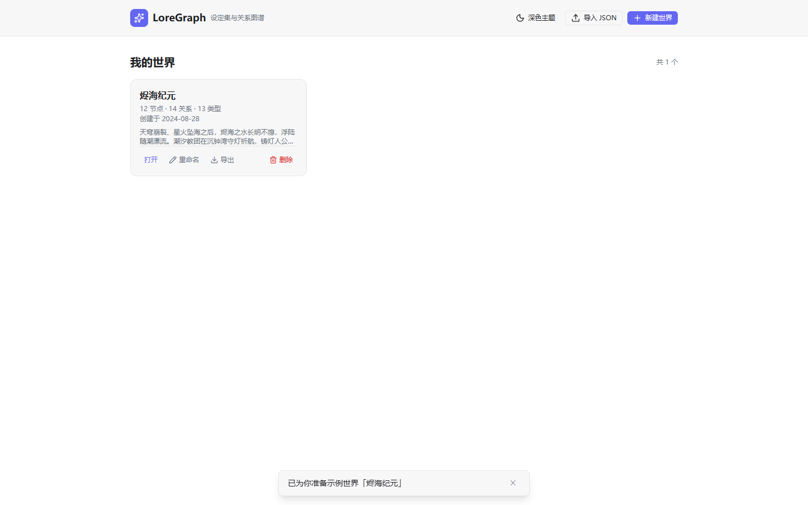
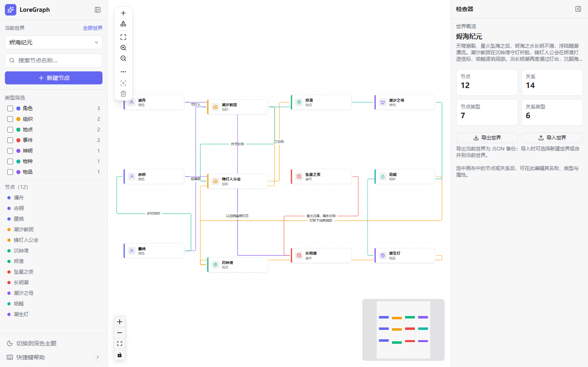
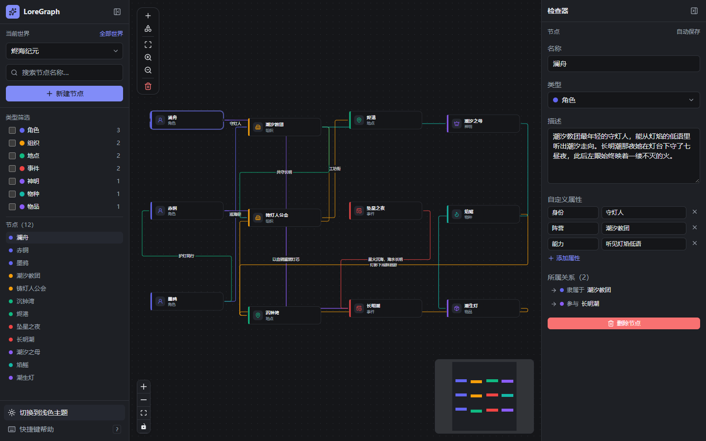
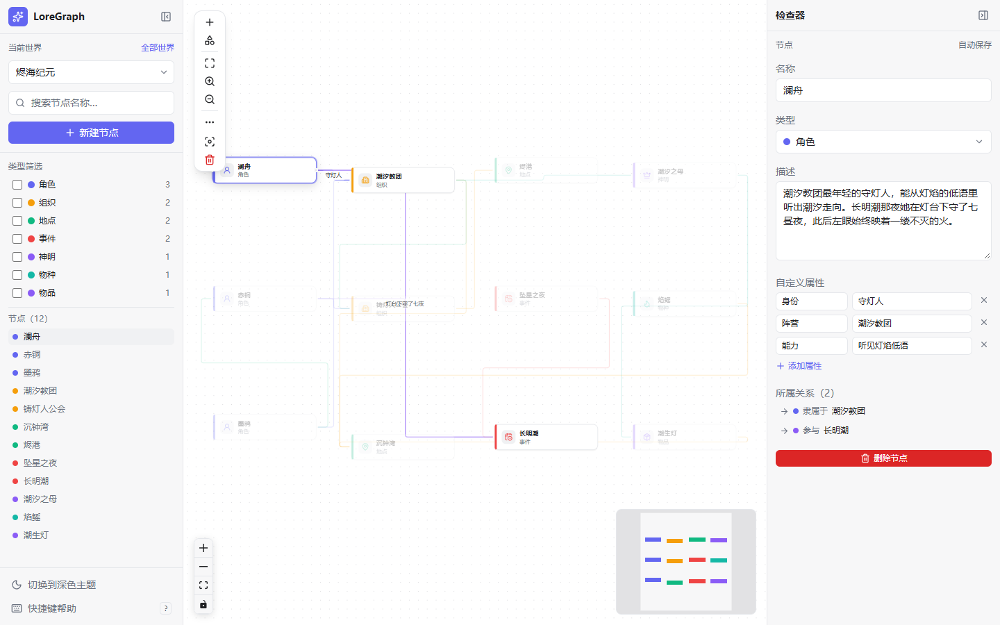

# LoreGraph

**面向虚构世界观构建的本地优先知识图谱工具。**

LoreGraph 是给写作者、跑团主持人和设定集爱好者用的 Web 端世界观管理工具。角色、地点、组织、
事件、物品都是无限画布上的节点，节点之间的关系是有向的边。全部运行在浏览器里，数据保存在本地，
没有账号、没有后端、没有遥测。

界面当前为中文；本 README 提供 [English](README.md) 与简体中文两个版本。

## 截图

**世界列表** —— 在一个本地资料库中管理多个世界。



**工作区** —— 图谱画布与左右两侧面板（浅色主题）。



| 深色主题                                                 | 检查器                                             |
| -------------------------------------------------------- | -------------------------------------------------- |
|  |       |
| 同一世界的深色模式。                                     | 编辑节点的名称、类型、描述、自定义属性与关联关系。 |

所有截图均在 1440×900 下拍摄。

## 核心特性

- **本地优先。** 世界数据存放在浏览器的 IndexedDB 中，无需注册、没有服务器，数据不会上传。
- **图谱画布。** 支持平移、缩放、拖拽节点；从节点拖出连线即可建立关系，弹窗中选择关系类型并填写可选
  标签。画布自带背景网格、缩放 / 适应视图控制条与可拖拽小地图，并在连线时校验自连与重复关系。
- **实体类型管理。** 在类型管理对话框中新建、改名、改色、删除节点类型与关系类型；每个类型有中文
  名称、颜色与可选图标，并显示被多少节点 / 关系引用。新建世界默认带 6 个节点类型（角色、组织、地点、
  事件、物品、概念）和 6 个关系类型（隶属于、结盟、位于、参与、导致、相关）。
- **检查器面板。** 编辑节点的名称、类型、长文本描述与任意自定义属性（字符串、数字、布尔），查看
  并跳转该节点的所属关系；编辑关系时可修改类型、标签与属性。未选中任何元素时展示世界统计与导入导出
  操作。
- **搜索与筛选。** 按名称搜索节点（不区分大小写的子串匹配），在侧边栏节点列表中浏览结果、在画布上
  高亮命中节点，并按类型显示或隐藏节点、显示各类型数量。
- **快捷键。** `N` 新建节点，`Delete`/`Backspace` 删除选中项，`Esc` 取消选中，`Ctrl/⌘+K`
  聚焦搜索框，`?` 打开快捷键帮助。
- **自动保存。** 编辑立即反映到界面，短暂防抖后写入 IndexedDB；写入失败时回滚到上一次已保存状态。
- **安全删除。** 删除节点会在同一事务内删除其关联关系，并提供撤销提示；仍被引用的类型不允许删除。
- **世界管理。** 以卡片列表新建、重命名、删除世界，并显示每个世界的节点 / 关系 / 类型数量；
  每个世界拥有独立的类型、节点与关系。
- **内置示例世界。** 随应用附带一个原创中文奇幻世界「烬海纪元」，资料库为空时首次打开会自动载入，
  也可从空状态页手动加载。
- **JSON 导入导出。** 通过 `.loregraph.json` 文件在浏览器之间迁移世界或做备份；导入失败时会
  按字段路径列出问题，而不是静默失败（见 [数据格式](docs/data-format.md)）。
- **明暗主题。** 默认跟随系统配色，并记住你的选择。
- **响应式工作区。** 桌面端三栏布局；窄屏时侧边栏与检查器变为抽屉。

## 技术栈

| 领域     | 选型                                                            |
| -------- | --------------------------------------------------------------- |
| UI 框架  | Vue 3（Composition API，`<script setup lang="ts">`）            |
| 语言     | TypeScript（strict）                                            |
| 构建工具 | Vite 8 + `@vitejs/plugin-vue`                                   |
| 样式     | Tailwind CSS v4 + CSS 设计令牌                                  |
| 状态管理 | Pinia                                                           |
| 路由     | Vue Router 5（HTML5 history 模式）                              |
| 图谱画布 | Vue Flow（`@vue-flow/core` 及 background / controls / minimap） |
| 持久化   | Dexie 4（IndexedDB，数据库名 `loregraph`）                      |
| 校验     | Zod 4                                                           |
| 图标     | Lucide（`@lucide/vue`）                                         |
| 测试     | Vitest + Vue Test Utils + `fake-indexeddb`；Playwright 负责 E2E |
| 质量     | ESLint（flat config）+ Prettier，`vue-tsc` 做类型检查           |

## 快速开始

**环境要求：** Node.js **24.12 或更高版本**（`engines` 字段也允许 22.18+），包管理器为
npm。

```bash
npm install
npm run dev          # 开发服务器：http://127.0.0.1:5173
```

构建与预览生产包：

```bash
npm run build        # 类型检查 + 构建到 dist/
npm run preview      # 本地预览构建产物
```

检查与测试：

```bash
npm run type-check
npm run lint
npm run test:unit
```

测试规模为 **100 个单元测试（13 个文件）**（Vitest + jsdom + `fake-indexeddb`）与
**33 个端到端测试（8 个文件）**（Playwright，Chromium）。首次运行前安装浏览器，再执行
E2E：

```bash
npx playwright install chromium
npm run test:e2e
```

CI（`.github/workflows/ci.yml`）在每次 push 与 pull request 时依次执行：lint → 类型检查 →
单元测试 → 生产构建 → Playwright E2E（使用 Chromium）。任务失败时会归档 Playwright 报告与
测试结果。

## 架构简述

应用按 **组件 → Pinia stores / composables → services → repositories → Dexie** 分层。业务规则
与 Zod 校验位于 services；持久化被仓库接口隔离，单元测试可以改用内存仓储。Stores 只持有视图
状态并编排服务调用，组件负责渲染与触发意图。

```text
src/
├─ db/              Dexie 数据库定义（表与索引）
├─ models/          Zod schema 与推导出的领域类型
├─ repositories/    仓库接口 + 内存 / Dexie 适配器
├─ services/        业务规则、导入导出、自动保存、错误类型
├─ stores/          Pinia stores（universe、types、graph、ui）
├─ composables/     主题、通知、快捷键与视口组合式函数
├─ components/      Vue 组件：common/、layout/、editor/、graph/
├─ views/           路由级视图
├─ router/          路由：/（世界列表）、/u/:universeId（工作区）
└─ styles/          Tailwind 入口与设计令牌
```

完整设计见 [docs/architecture.md](docs/architecture.md)：自动保存与撤销语义、世界隔离、
级联删除，以及 v0.1 的跨标签页限制。

## 数据与隐私

- 所有数据存放在浏览器的 IndexedDB 中；世界数据不会上传，应用也不会请求任何第三方服务器。
  唯一的网络请求是加载应用自身提供的内置示例世界文件。
- 没有账号、没有云同步、没有埋点统计。
- 清除站点数据（或使用无痕窗口）会删除全部世界；**请定期导出备份**。
- 导出的文件包含整个世界：名称、描述、自定义属性、坐标与时间戳，分享前请自行检查。
- 格式说明见 [docs/data-format.md](docs/data-format.md)。

## 路线图

**v0.1（当前）**——图谱画布、搜索与筛选、带自定义属性的检查器、世界管理、内置示例世界、
JSON 导入导出、明暗主题、自动保存、快捷键。

**后续（大致顺序）**——百科列表视图、时间线、地图视图、图片附件、AI 辅助世界观构建、云同步、
实时协作、插件系统。

具体优先级通过 GitHub issue 追踪；v0.1 有意不包含上述大功能，以保证核心编辑链路小而可靠。

## 贡献

欢迎贡献代码与文档。请先阅读 [CONTRIBUTING.md](CONTRIBUTING.md)，其中包含环境、脚本、代码风格、
测试要求与提交信息约定；Bug 与功能请求请使用
[.github/ISSUE_TEMPLATE](.github/ISSUE_TEMPLATE) 中的模板。

## 协议

[MIT](LICENSE) © 2026 LoreGraph 贡献者
